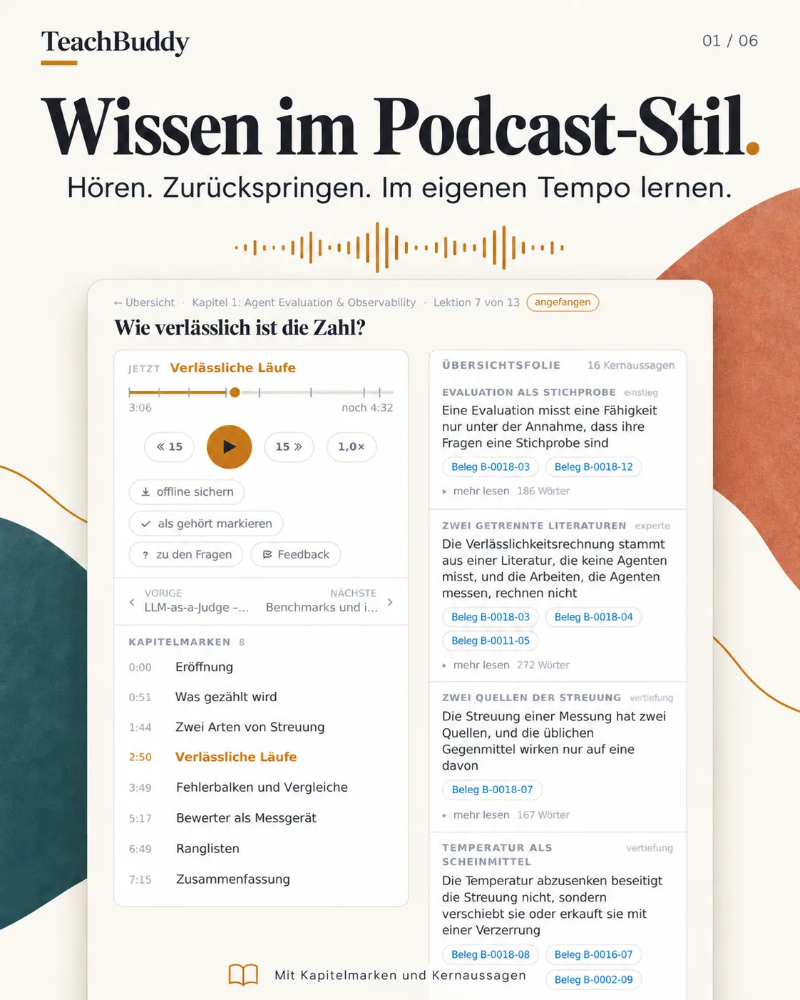
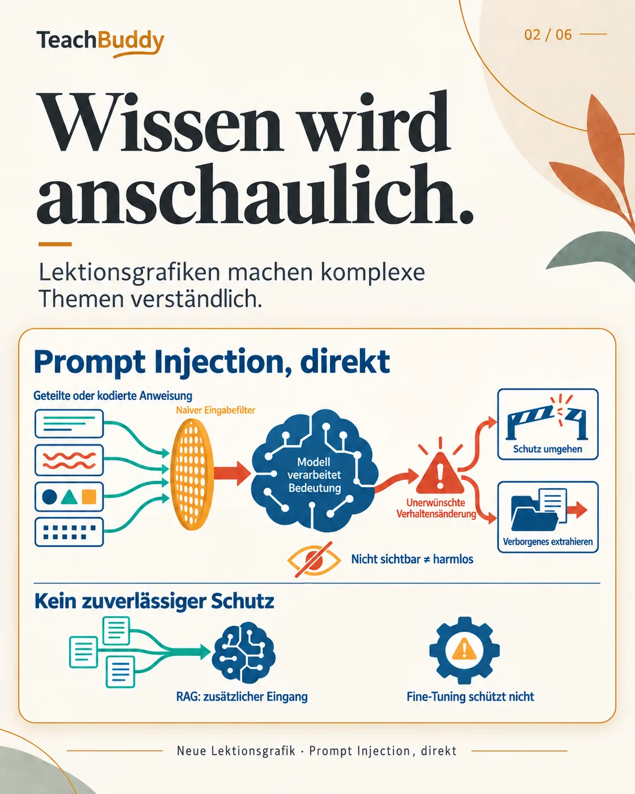
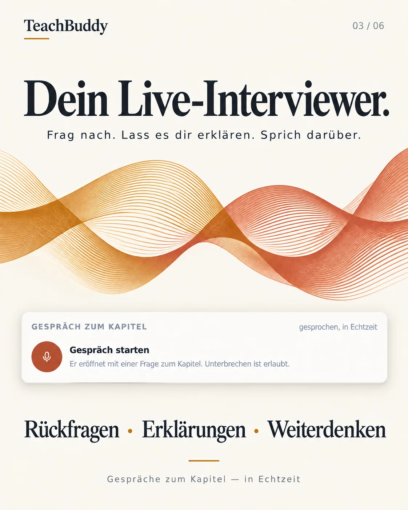

# TeachBuddy

**Bau dir deinen eigenen Kurs zu jedem Thema — als Podcast zum Hören, mit
Bildern, Mindmap und einem Gesprächspartner. Und hinter jeder Aussage steht
ihre Quelle.**

Du sagst, was du lernen willst. Agenten recherchieren Quellen, schneiden das
Wissen in kleine belegte Einheiten, lassen ein zweites Modell jede Aussage
gegenprüfen und machen daraus Lektionen: eine Podcast-Folge mit zwei Stimmen,
ein Bild, das die Zusammenhänge zeigt, eine Übersichtsfolie und Fragen. Je
Kapitel kommen eine Mindmap und ein Gesprächspartner dazu, mit dem du über das
Thema sprechen kannst. Du gibst frei, was gelten soll — und lernst dann
unterwegs in einer App, die auch offline läuft.

<p align="center">
  
  
  
</p>

**[Projektseite](https://niclaseschner-ship-it.github.io/teachbuddy/)** ·
[Einrichten](#einrichten) · [Eigener Lernpfad](docs/eigener-lernpfad.md) ·
[Architektur](docs/architektur.md) · [English](#english)

## Was dabei herauskommt

| | |
|---|---|
| **Podcast je Lektion** | Moderator und Gast, 5–10 Minuten, Kapitelmarken, Tempo, offline speicherbar |
| **Lektionsbild** | eine Infografik je Lektion, die für sich allein erklärt, worum es geht |
| **Übersichtsfolie** | die Kernaussagen, jede mit ihrem Beleg — oder sichtbar als Einordnung markiert |
| **Mindmap je Kapitel** | die Gliederung aller Wissenseinheiten nach Leitfragen |
| **Gesprächspartner** | Sprachgespräch zum Kapitel in Echtzeit, auf dem Kapitelwissen |
| **Belege** | von der Aussage zum wörtlichen Zitat und zur Quelle — auch offline |
| **Fragen und Lernstand** | drei bis vier Fragen je Lektion, Fortschritt über Geräte hinweg |

## Einrichten

Am einfachsten mit einem Coding-Agenten: Öffne das Repo in
[Claude Code](https://claude.com/claude-code) oder Codex und sag
**„Richte TeachBuddy ein"**. Der mitgelieferte Skill
([`.claude/skills/teachbuddy/SKILL.md`](.claude/skills/teachbuddy/SKILL.md))
klärt einmal, was du vorhast und welche Zugänge du hast, installiert, zeigt die
Demo, legt deine eigene Bibliothek an und begleitet den ersten Lernpfad bis zur
Freigabe — und danach den Betrieb fürs Telefon.

Von Hand geht es so:

```bash
git clone https://github.com/niclaseschner-ship-it/teachbuddy.git && cd teachbuddy
python3 -m venv .venv && source .venv/bin/activate
pip install -e .
python start.py --pruefen        # was da ist und was fehlt
python start.py --audio          # Demo starten → http://127.0.0.1:5089/
```

## Was du brauchst

| wofür | was |
|---|---|
| **Lernen** (Demo oder fertige Bibliothek) | Python 3.10+ — sonst nichts |
| **Gesprächspartner** | ein OpenAI-API-Schlüssel (Realtime) |
| **Eigene Lernpfade bauen** | [Claude Code](https://claude.com/claude-code) und [Codex CLI](https://github.com/openai/codex), jeweils mit Abo oder API-Schlüssel; Azure OpenAI mit einem TTS-Deployment für die Vertonung; `ffmpeg` |

Fehlt dir einer dieser Bausteine, lässt er sich austauschen: Kein Modul
spricht direkt mit einem Anbieter (TB-7). Der Skill zeigt, wo — und baut es
mit dir um, etwa die Vertonung auf OpenAI-TTS statt Azure.

## Die Demo

Unter `demo/` liegt ein fertiges Kapitel: **„Datenhoheit und Souveränität"** —
acht Lektionen darüber, wohin Daten bei KI-Diensten gehen, wer darauf
trainiert, was Verträge regeln und wie man wieder herauskommt. 31
Wissenseinheiten aus neun Quellen, darunter DSGVO, Data Act und die Bedingungen
großer Anbieter.

Es zeigt auch den Weg dorthin: Die Gegenprobe hat zehn Aussagen beanstandet,
alle wurden an den Quellen nachgeprüft und eingearbeitet
([`demo/pruefung/K-03-1.md`](demo/pruefung/K-03-1.md)), und eine Lektion bekam
einen ehrlicheren Titel, weil der Skript-Agent sich weigerte, mehr zu erzählen,
als das Material trägt.

## Wie es gebaut ist

```
bibliothek/  liest eine Bibliothek, baut den Index, legt neue an
dienst/      Flask-Dienst: Lektionen, Belege, Lernstand, Gespräch
app/         die PWA — HTML, CSS, ES-Module, kein Build-Schritt
pipeline/    die Warteschlange, die aus einem Lernpfad Inhalte macht; Lektionsbilder
podcast/     Skript, Belegprobe, Vertonung, Zusammenfügen einer Folge
auftraege/   die Aufträge an die Agenten (Curriculum, Recherche, Modell, Prüfung)
demo/        die Demo-Bibliothek
specs/       wie sich TeachBuddy verhalten soll — die Quelle der Wahrheit
decisions/   warum es so gebaut ist
```

Drei Grundsätze tragen alles ([`specs/constitution.md`](specs/constitution.md)):
**Belegt oder als Einordnung markiert** — nichts ohne Quelle. **Wissen und
Darbietung sind getrennt** — dieselbe Wissenseinheit wird Podcast, Folie,
Frage und Mindmap. **Ein Mensch gibt frei** — Agenten schlagen als Git-Diff
vor, ein Commit ist die Freigabe.

## Tests

```bash
pip install -e ".[dev]"
python -m pytest -q          # gegen die Demo-Bibliothek
node --test app/tests/       # App (Node 20+)
```

## Lizenz

Code: [Apache-2.0](LICENSE). Inhalte der Demo: [CC BY 4.0](demo/LIZENZ.md) —
zitierte Quellen behalten ihre eigene Lizenz. Stimmen und Lektionsbilder sind
KI-erzeugt.

---

## English

**TeachBuddy builds your own course on any topic: agents research sources,
cut the knowledge into small units with evidence, have a second model
cross-check every claim, and turn it into lessons — a two-voice podcast
episode, an explanatory infographic, a summary slide and questions — plus a
mind map and a real-time voice conversation partner per chapter. You approve
what counts, then learn on the go in an offline-capable app. Every statement
links to its source.**

The app, the code and the demo are in German. Open the repo in Claude Code or
Codex and say "set up TeachBuddy" — the bundled skill walks you through
installation, your own library, your first learning path and running it for
your phone. Learning needs only Python; the conversation needs an OpenAI key;
building content uses the Claude Code and Codex CLIs and Azure OpenAI TTS (each
replaceable). Code Apache-2.0, demo content CC BY 4.0.
